# 淘淘喂养（taotaofeed）

给新生儿家庭用的喂养记录工具：全家人用各自的手机浏览器打开同一个网页，记喂奶、尿布、吸奶、补剂，随时看到「距上次喂奶多久了」。数据只存在你自己的服务器上。

- 一个容器、一个数据文件，不依赖数据库或其他服务，镜像约 60 MB
- 手机网页，深色界面，夜里喂奶不刺眼；可以「添加到主屏幕」当应用用
- 多台手机同时记录，每条记录标明是哪台设备记的
- 可以对 Siri 说「开始喂奶」「换尿布了」来记录，问「多久没喝奶了」来查询
- 可选的 AI 功能：每顿喂完自动分析、随时提问（需要自己填模型服务的地址和密钥，不填就没有这部分）

> 截图里的宝宝「小汤圆」和所有记录都是虚构的演示数据。

| 首页 | 结束喂奶 | 统计 |
| :---: | :---: | :---: |
| 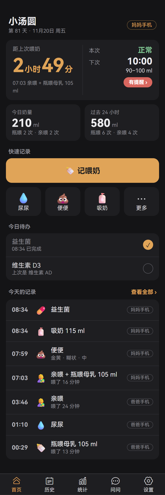 | 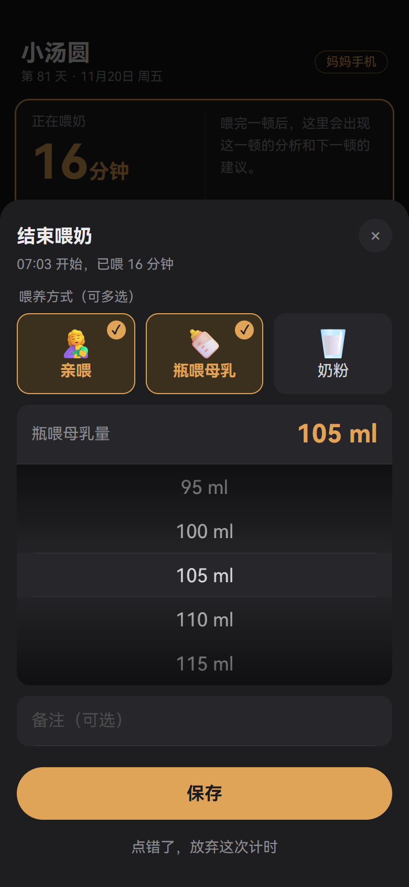 | 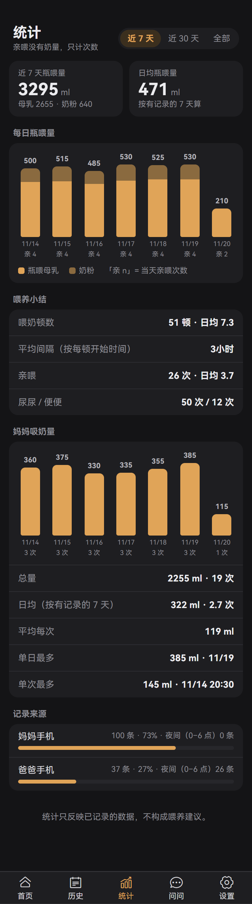 |

## 快速开始

```bash
docker run -d --name taotaofeed \
  -p 5883:5883 \
  -v taotaofeed-data:/data \
  --restart unless-stopped \
  zzzzzero/taotaofeed
```

或者用 Compose：

```yaml
services:
  taotaofeed:
    image: zzzzzero/taotaofeed:latest
    container_name: taotaofeed
    restart: unless-stopped
    ports:
      - "5883:5883"
    volumes:
      - ./data:/data   # 全部数据就是这里面的 taotaofeed.db
```

启动后用手机浏览器打开 `http://服务器地址:5883`。

- 镜像目前只有 amd64（x86_64）架构。
- 容器内以普通用户 `node`（编号 1000）运行。把宿主机目录挂到 `/data` 时，要让这个用户能写，例如 `chown 1000:1000 ./data`。
- 可用的环境变量：`PORT`（默认 5883）、`DATA_DIR`（默认 `/data`）。日期一律按北京时间计算。

## 第一次使用

1. **第一台打开网页的设备自动成为已登记设备**。给它起个名字（如「妈妈手机」）并设一个识别码。所以部署好之后请自己先打开一次。
2. 到「设置」里填宝宝的小名和出生日期，其他资料（性别、出生体重等）可选。
3. **其他手机**第一次打开会看到一个四位码，此时只能先记 1 条、看不到任何已有记录。在已登记的设备上打开「设置 → 设备」，找到这个四位码，起名并设识别码，它就能正常使用了。

| 新设备看到四位码 | 在已登记的设备上登记它 |
| :---: | :---: |
| 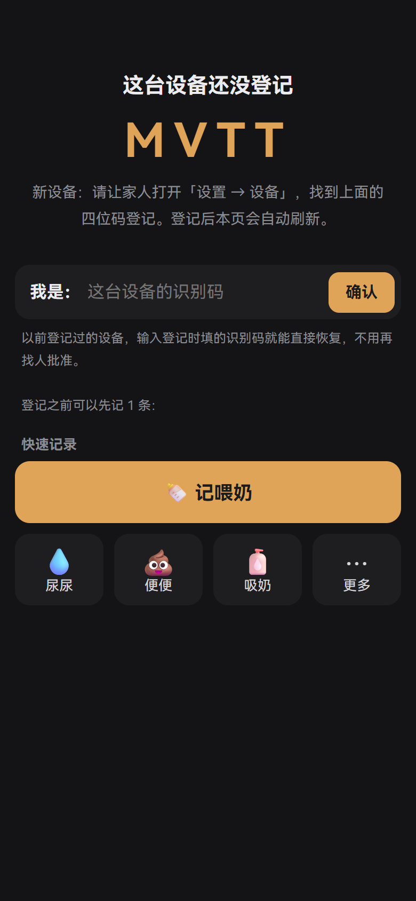 | 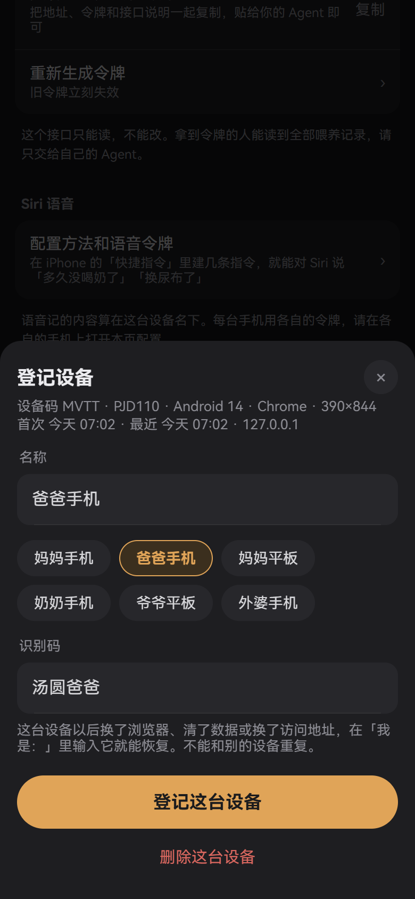 |

**识别码是什么**：每台设备登记时自己起的一个短语。以后这台设备换了浏览器、清了数据或换了访问地址，页面又回到四位码时，在「我是：」里输入识别码就能恢复成原来的设备，不用再找人批准。它只用来挡住外人，不区分家里人。

## 功能和用法

### 记喂奶

只有一个按钮。

- **开始喂的时候点一次**，首页开始计时。
- **喂完再点一次**，选喂养方式并保存。方式可以多选：亲喂、瓶喂母乳、奶粉任意组合，母乳和奶粉各设各的毫升数（5 ml 一档，初始值是上一次的量）。
- **忘了点开始**：开始后 5 分钟内再点一次就是「补录」，可以改时间、填喂了多久。

「距上次喂奶」从每顿的**开始**时间算。亲喂没有奶量，只计次数。

| 喂奶计时中 | 结束时选方式和奶量 |
| :---: | :---: |
| 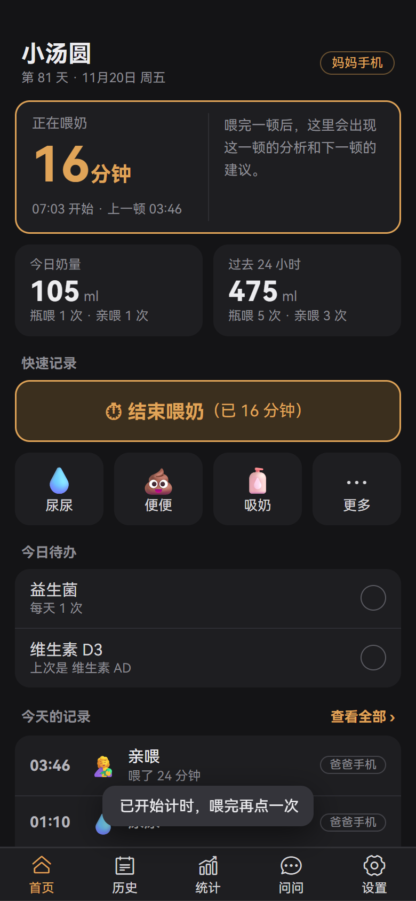 |  |

### 快速记录

- **尿尿**：点一下就存，底部提示条可以撤销。
- **便便**：默认「金黄、糊状、中」，不一样再改。
- **吸奶**：滚轮选毫升数。
- **更多**：补剂、体温、体重、身长、洗澡、游泳、抚触、用药等。

点任何一条记录可以修改或删除。在页面顶部下拉再松手可以刷新。

| 便便 | 历史 |
| :---: | :---: |
| 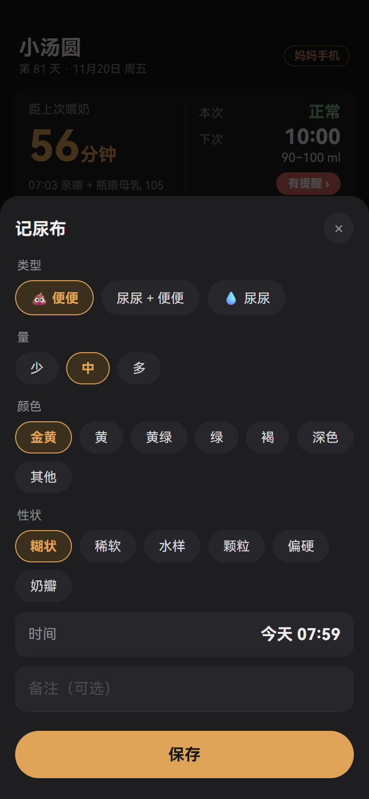 | 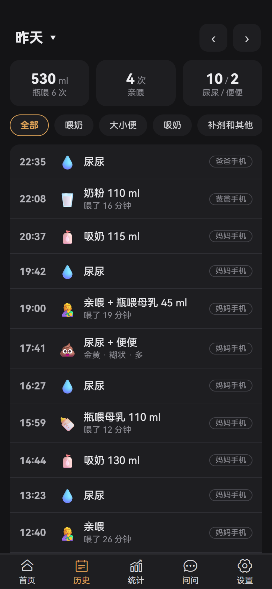 |

### 今日待办（补剂）

在「设置 → 每日补剂」里添加。两种方式：「每天 1 次」，或「隔日交替」（比如维生素 D3 和 AD 轮流吃，首页一天只提醒其中一种，并告诉你上次吃的是哪种）。在首页点一下就记为已完成。

### 历史和统计

- **历史**：按天翻看，可以只看某一类记录，也可以往过去的某一天补录。
- **统计**：近 7 天、近 30 天或全部。包括每日瓶喂量（母乳和奶粉分色）、喂奶顿数和平均间隔、亲喂次数、尿便次数、妈妈吸奶量、每台设备记了多少条。

### AI 分析和「问问」（可选）

在「设置 → AI 模型」里添加模型后才会出现。支持 OpenAI 兼容和 Anthropic 两种接口格式：填接口地址和密钥，模型名从接口返回的列表里选。可以加多个，按顺序使用，前面的连不上自动换下一个。

- **喂完自动分析**：每次结束喂奶后，首页卡片右半边显示这一顿是否正常、建议的下次时间和奶量；点开看详细分析和提醒（比如今天的补剂还没吃）。
- **问问**：一个全家共用的对话页，可以问「最近的喂养情况怎么样」之类的问题，模型会结合近期记录和宝宝资料回答。

开启后，喂养记录和你填的宝宝资料会发给你配置的模型服务。分析结果只供参考，不能代替医生的意见。

| 这一顿的分析 | 问问 |
| :---: | :---: |
| 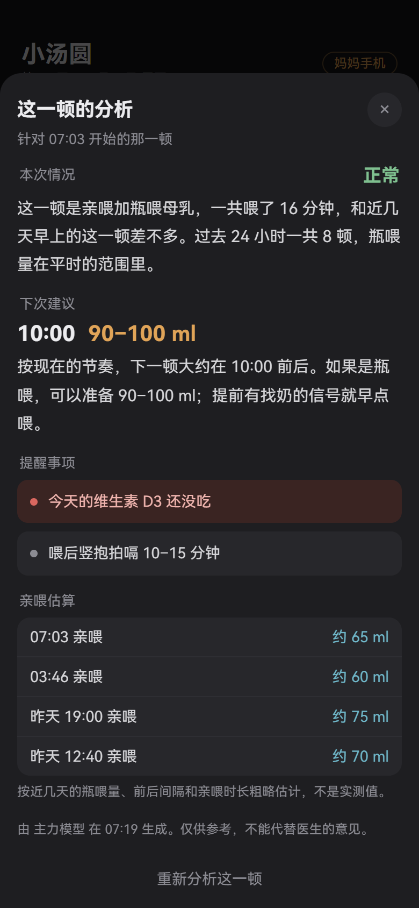 | 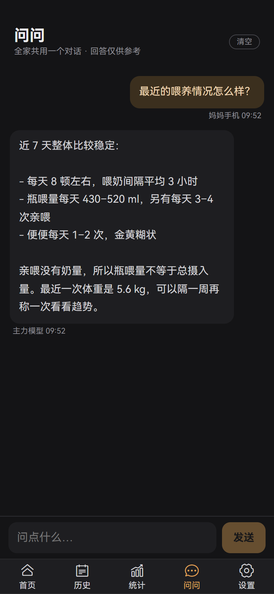 |

### 用 Siri 记录和查询

在 iPhone 的「快捷指令」里建几条指令（「设置 → Siri 语音」里有照着填的步骤、接口地址和这台设备的语音令牌；一个人建好后把 iCloud 分享链接贴进去，家里其他手机可以直接导入），之后不用打开网页，直接对 Siri 说：

| 对 Siri 说 | 效果 |
| --- | --- |
| 开始喂奶 | 开始计时 |
| 喂奶结束 → Siri 问「喝了多少？」→ 90 / 奶粉 120 / 亲喂 / 亲喂加 60 | 结束计时并记下方式和奶量（只说数字按瓶喂母乳记） |
| 换尿布了 | 记一条尿尿 |
| 便便了 / 拉臭臭了 | 记一条便便 |
| 多久没喝奶了 / 下顿啥时候 | Siri 念出：距上次喂奶多久、上一顿喝了什么；配了 AI 模型时还有建议的下顿时间和奶量 |
| 撤销 | 撤掉这台设备 10 分钟内最后记的一条 |

这些说法都是按规则识别的，不经过大模型，一两秒就有回答。语音记的内容算在领令牌的那台设备名下。只支持苹果设备（iPhone、Apple Watch、HomePod 等能运行快捷指令的设备）。

| Siri 的配置说明 | | |
| :---: | :---: | :---: |
| 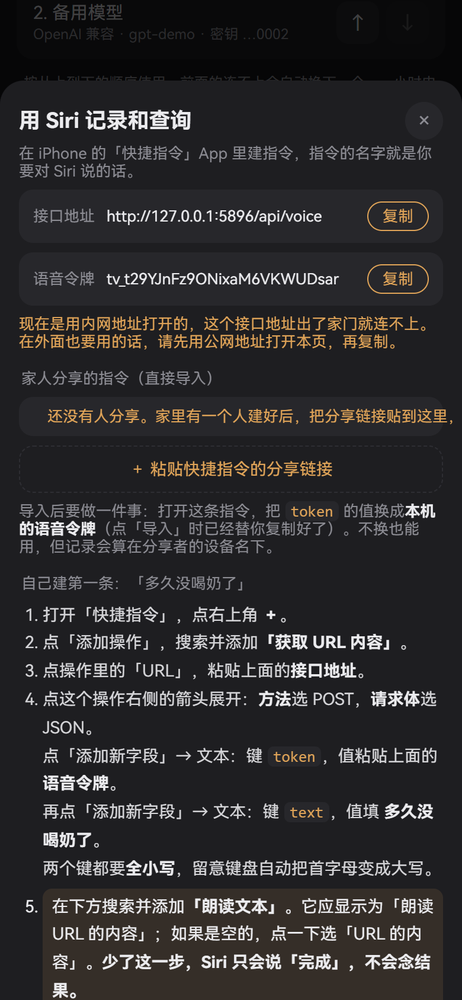 | | |

### 给 Agent 的只读接口

「设置 → 给 Agent 的接口」可以一键复制接口地址、令牌和用法说明，贴给你自己的 AI 助手，它就能读取喂养数据（概况、逐日汇总、原始记录）。这个接口只能读、不能改；令牌可以随时重新生成。

### 设置

宝宝资料、每日补剂、AI 模型、Agent 接口、设备管理都在这一页。

| 设置 | | |
| :---: | :---: | :---: |
| 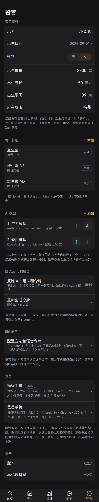 | | |

## 数据和备份

全部数据是 `/data/taotaofeed.db` 一个文件（SQLite）。备份时先停容器，再把整个数据目录复制走；恢复就是放回去。升级只需要拉新镜像后重建容器，数据结构会自动升级。

## 放到公网

工具自己不提供 https 和账号密码，靠「设备登记」挡住外人：没登记的设备看不到任何记录。要在外面访问，请在前面加一层带 https 的反向代理。

## 兼容性

近几年的手机浏览器都可以用；也照顾了老设备（iPadOS 12 的 Safari）。
